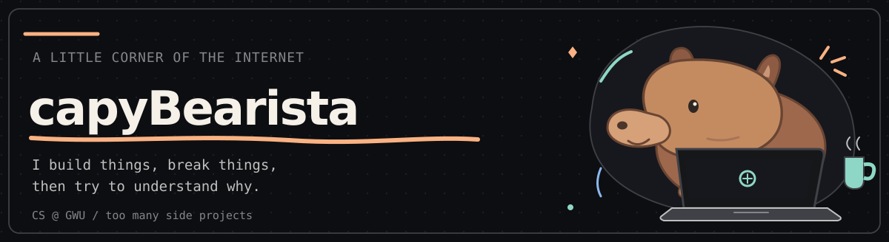

<h1>👋🏽 Hey, Arjun here!</h1>

  

I'm Arjun Pramanik, a computer science undergrad at **George Washington University** who loves to build (and occasionally break) things with a strategist's mindset. My experience in everything from AI/ML projects to strategy consulting has convinced me that technology's real promise is to **solve human problems, not create new ones**. I care about privacy and the people on the other side of the screen, and I tend to ask *why?* and *who benefits?* before getting too caught up in *how?*

Lately, I've been especially curious about how machine learning models actually **learn**—not just how to plug them into an app. I'm hoping to get deeper into the research and training side of ML. In the meantime, I keep getting sidetracked by coding tools, my homelab, and ideas that probably didn't need to become entire projects :)

  <picture>
    <source media="(prefers-color-scheme: dark)" srcset=".github/assets/profile-header-dark.svg" />
    <source media="(prefers-color-scheme: light)" srcset=".github/assets/profile-header-light.svg" />
    
  </picture>

  <a href="https://linkedin.com/in/arjun-pramanik">LinkedIn</a> ·
  <a href="mailto:capybearista@gmail.com">Email</a>

---

### Things I've been building

- **[opencode-plugins](https://github.com/capyBearista/opencode-plugins)** — I kept finding little things I wanted to change about OpenCode, so I started writing plugins. It's grown into a collection covering agent configs, code reviews, navigation, and other tiny annoyances.
- **[yt-content-digest](https://github.com/capyBearista/yt-content-digest)** — For the pile of YouTube videos I swear I'll watch *eventually*. Pulls transcripts and comments together and uses local or hosted LLMs to help me make sense of them.
- **[phish-net](https://github.com/capyBearista/phish-net)** — A phishing-email analyzer that runs with Ollama on your own machine. Suspicious email is bad enough without having to send it off to another server.
- **[alien-detector](https://github.com/capyBearista/alien-detector)** — A Halloween computer-vision project with hand tracking and a very scientific™ definition of an alien hand. Made with Thanh Van Nguyen at the Quincy College Computer Club. 👽

I also tinker with [self-hosting](https://github.com/capyBearista/home-server) and once got annoyed enough by a bright website to make [an entire dark-mode userscript](https://github.com/capyBearista/artificial-analysis-dark-mode).

### Skills & Tools

- **Languages:** Python, TypeScript / JavaScript, C++, Bash, HTML & CSS
- **Usually nearby:** Linux, Git, Docker + Compose, Jupyter, Ollama, OpenCV

### Away from the keyboard

Photography! I like wandering around with a camera and catching the world from a different perspective. 📷
